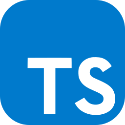
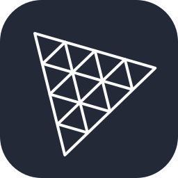
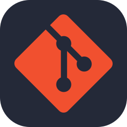
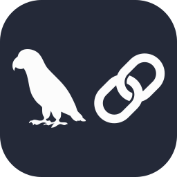
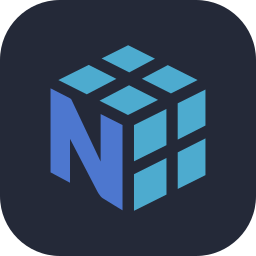
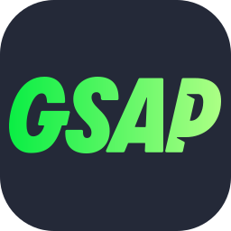
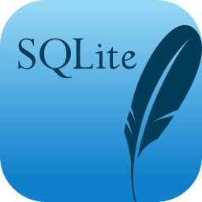

<!-- ============================================================ -->
<!--                            HEADER                            -->
<!-- ============================================================ -->
<div align="center">

# Yixiong Li

#### AI Product Designer · Agent Builder · CS @ TYUT

<a href="https://git.io/typing-svg">
  
</a>

<br />

[](https://liyixiong.cn/profile)
[](mailto:liyixiong2022@163.com)
[](https://github.com/liiiyiiixiii)

</div>

---

<div align="center">

### 🚀 _“让 AI 帮助人表达创意，把真实需求变成可用的产品。”_

<sub>Helping people create with AI and turning real needs into useful products.</sub>

</div>

<table>
<tr>
<td width="60%" valign="top">

## 👋&nbsp;Who&nbsp;I&nbsp;Am

我是 **力一雄（Yixiong Li）**，就读于太原理工大学计算机科学与技术专业，关注 **AI 产品设计、Agent 工作流与全栈开发**。

我喜欢从真实需求出发，把产品想法做成可以体验的应用。曾参与 AI 数学辅导模块的设计与上线，也在剧情游戏制作中，将内容改编和素材生产的方法沉淀为可复用的创作 Skills。

当前关注 **AI 创作工具与教育应用**，持续探索用户反馈如何转化为更清晰的交互、更可靠的工作流和具体的产品改进。

</td>
<td width="40%" valign="top">

## ⚡&nbsp;At&nbsp;a&nbsp;Glance

```yaml
name: Yixiong Li
role: AI Product Designer · Agent Builder
school: 太原理工大学（211）
major: 计算机科学与技术
class: 卓越工程师班
education: 2025.09—2029.06（预计）
program: TYUT 计算菁英计划
research: SKILIS 具身智能方向科研成员
community: TYUT AIGC 社团发起人
focus: AI Products · Creative Tools · Education
```

<sub>SKILIS：工业互联网安全山西省重点实验室。</sub>

</td>
</tr>
</table>

---

## 🔭 Currently Building & Learning

<table>
<tr>
<td width="50%" valign="top">

### 🛠️&nbsp;Building

- 将剧情游戏制作中的方法沉淀为 **可复用的创作 Skills**
- 围绕 **内容整理与创意表达**打磨 AI 应用交互
- 结合 **用户反馈**改进产品流程与体验入口

</td>
<td width="50%" valign="top">

### 🌱&nbsp;Learning&nbsp;&amp;&nbsp;Exploring

- **Agent 工作流编排**与人机协作边界
- **Context Engineering** 与工具调用
- AI 应用的评测、失败恢复与质量验证
- 用户研究、产品实验与反馈驱动的迭代

</td>
</tr>
</table>

---

## 🧰 Tech Stack

<div align="center">
  
  &nbsp;&nbsp;
  
  &nbsp;&nbsp;
  
  &nbsp;&nbsp;
  
</div>

<br />

<table align="center">
<tr>
<td align="right" width="190"><b>🧠 Languages & Core</b></td>
<td nowrap width="500">
  
  
  
  
  
  
</td>
</tr>
<tr>
<td align="right"><b>🤖 AI & Backend</b></td>
<td nowrap width="500">
  
  
  
</td>
</tr>
<tr>
<td align="right"><b>🎨 Frontend & Creative</b></td>
<td nowrap width="500">
  
  
  
  
  
  
  
  
</td>
</tr>
<tr>
<td align="right"><b>📦 Data & Delivery</b></td>
<td nowrap width="500">
  
  
  
  
  
  
</td>
</tr>
</table>

---

## 🏆 Selected Work & Achievements

| 🔗&nbsp;Repository&nbsp;/&nbsp;Project | 🏅&nbsp;Achievement | 🛠️&nbsp;My&nbsp;Contribution |
|:---|:---:|:---|
| **[高墙之外](https://github.com/SSxs-wym/Beyond-The-Walls-)** | 抖音创变者计划黑客松联赛<br>**国赛二等奖** | **核心内容策划与主流程开发**：将线性叙事改编为可交互剧情，负责任务推进、NPC 交互、检查点与存档；结合十余名体验玩家的反馈，迭代引导、地图与主线体验。 |
| **[Create-World-skills](https://github.com/liiiyiiixiii/Create-World-skills)** | **可复用创作 Skills**<br>角色与场景生成模块可用 | 将游戏制作中的内容理解、改编与素材生产方法整理为模块化 Skills。内容理解、美术方向与对白模块处于 Beta，尚未形成完整自动化流水线。 |
| **[Weeknote](https://github.com/liiiyiiixiii/weeknote)** | **AI 周报应用**<br>可编辑 · 可导出 Word | 围绕零散记录整理周报的需求，提供附件输入、模板组织、对话修改与 Word 导出，支持用户在生成初稿后继续核对和完善。 |
| **Math AI Tutor** | **AI 数学辅导模块已上线** | **产品设计与全栈开发**：分析真实用户反馈，设计宠物学习伙伴、分层提示与引导追问，完成前端交互、后端接口及大模型 API 集成。 |
| **Long-term AI** | **AI 安全产品体系与体验入口** | **产品与商业分析**：盘点科研资产、梳理官网产品体系，接入体验入口与行为埋点，并参与页面排序 A/B 实验，为展示方案调整提供依据。 |

---

## 📌 Featured Projects

<div align="center">

[](https://github.com/liiiyiiixiii/Create-World-skills)
[](https://github.com/SSxs-wym/Beyond-The-Walls-)
[](https://github.com/liiiyiiixiii/weeknote)

[Create-World-skills](https://github.com/liiiyiiixiii/Create-World-skills) · [高墙之外](https://github.com/SSxs-wym/Beyond-The-Walls-) · [在线试玩](https://www.liyixiong.cn/game/) · [Weeknote](https://github.com/liiiyiiixiii/weeknote)

</div>

---

## 🐍 Contribution Journey

<div align="center">

<picture>
  <source media="(prefers-color-scheme: dark)" srcset="https://raw.githubusercontent.com/liiiyiiixiii/liiiyiiixiii/output/github-contribution-grid-snake-dark.svg?v=20261020" />
  <source media="(prefers-color-scheme: light)" srcset="https://raw.githubusercontent.com/liiiyiiixiii/liiiyiiixiii/output/github-contribution-grid-snake.svg?v=20261020" />
  
</picture>

</div>

---

<div align="center">

## 一起创造有价值的 AI

如果你也在探索 AI 创作工具、教育应用或 Agent 工作流，欢迎交流产品想法、用户需求和实践经验。

**Have an idea for a useful AI product? Let's talk.**

[Portfolio](https://liyixiong.cn/profile) · [Email](mailto:liyixiong2022@163.com) · [GitHub](https://github.com/liiiyiiixiii)

<br />

<sub>Made with curiosity, user feedback, and a commitment to useful AI.</sub>

</div>
